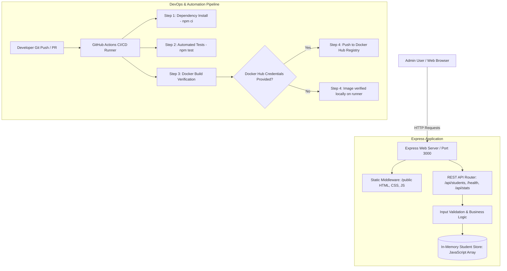

# StudentHub: Student Management System with GitHub Actions CI/CD & Docker

[](https://github.com/Pratyush-Px/CI-CD/actions)


A clean, production-styled college administration dashboard and REST API built with Node.js, Express, vanilla HTML5/CSS3/JavaScript, and Bootstrap 5. Containerized with Docker and continuously verified through an automated GitHub Actions CI/CD pipeline.

---

## 1. Project Overview

**StudentHub** is an academic administration platform that allows college administrators to record, view, search, filter, update, and manage student enrollments across university departments. 

Designed specifically as an undergraduate **Cloud Automation & DevOps** project, the system combines:
- A responsive, restrained, professional frontend dashboard (without heavy frontend frameworks or build tooling).
- A robust Node.js/Express RESTful backend with thorough input validation and in-memory persistence.
- Automated unit and integration testing using Node.js native test runner (`node --test`) and Supertest.
- Containerization using a lightweight Alpine-based `Dockerfile`.
- Automated Continuous Integration (CI) and Continuous Delivery (CD) workflow using GitHub Actions.

---

## 2. Problem Statement

Academic institutions frequently struggle with either:
1. Overly complex enterprise management software with steep learning curves and heavy database setups.
2. Fragile ad-hoc spreadsheets or localized scripts lacking automated testing, reproducible runtime environments, and modern deployment automation.

Furthermore, students studying Cloud Computing and DevOps need practical, demonstrable systems where the software engineering lifecycle (testing, container packaging, automated pipeline verification) is clear, reproducible, and verifiable without needing paid cloud tiers or complicated local CI servers like Jenkins.

---

## 3. Project Objectives

1. **Lightweight & Zero-Setup Architecture**: Implement a complete student administration dashboard with in-memory storage, eliminating external database server dependencies.
2. **Professional Academic UI**: Build a conventional, accessible, clean administrative UI adhering to academic design standards (restrained slate/blue palette, no distracting neon/glassmorphism effects).
3. **Automated Quality Assurance**: Achieve 100% test pass rate with deterministic automated tests testing all CRUD routes, validations, edge cases, and static asset delivery.
4. **Reproducible Containerization**: Package the Node.js application into a minimal, secure Docker image using multi-stage/Alpine best practices.
5. **Hands-Off Continuous Integration**: Implement a GitHub Actions workflow that automatically executes tests, builds the Docker image, and optionally delivers to container registries upon code pushes and pull requests.

---

## 4. Key Features

- **Dashboard Overview Metrics**:
  - **Total Students**: Real-time count of all active enrollments.
  - **Total Courses**: Count of academic departments currently represented.
  - **Recently Added Students**: Live count of students registered in the last 7 days.
  - **Students Added Today**: Live count of students enrolled today (server local date).
- **Student Records Management (CRUD)**:
  - **Create**: Add new students with full name, validated email, course selection, semester/year choice, and enrollment date.
  - **Read**: View complete student profiles with creation timestamps.
  - **Update**: Edit existing student records with in-place validation and email conflict prevention.
  - **Delete**: Remove student records with explicit confirmation modals.
- **Search, Filter, & Sorting**:
  - Instant client-side search matching student ID, name, email, or department.
  - Course-level filtering dropdown with dynamic options.
  - Sorting by Student ID (Asc/Desc), Full Name (A-Z / Z-A), and Enrollment Date.
  - One-click filter reset.
- **Secure DOM Rendering**:
  - User-provided data is escaped and rendered safely using DOM manipulation (`textContent`), preventing Cross-Site Scripting (XSS).
- **Responsive Layout**:
  - Collapsible slate sidebar with mobile drawer navigation.
  - Sticky top administrative navbar with quick actions.
  - Full keyboard accessibility and visible focus states.

---

## 5. Technology Stack

| Layer | Technologies Used | Description |
|---|---|---|
| **Backend** | Node.js (v20+ LTS), Express 5 | High-performance asynchronous HTTP REST API |
| **Frontend** | HTML5, CSS3, Vanilla JavaScript (ES6+), Bootstrap 5 | Lightweight, framework-free administration UI |
| **Testing** | Node Test Runner (`node:test`), Supertest | Native unit & integration testing framework |
| **Containerization** | Docker, Alpine Linux (`node:20-alpine`) | Minimal, reproducible container image |
| **CI/CD Pipeline** | GitHub Actions | Automated GitHub-hosted runner workflow |

---

## 6. Architecture Overview



---

## 7. Project Directory Structure

```text
student-management-cicd/
├── .github/
│   └── workflows/
│       └── ci-cd.yml         # GitHub Actions automated pipeline definition
├── public/
│   ├── app.js               # Frontend application logic (safe DOM rendering)
│   ├── index.html           # Semantic HTML5 administrative layout
│   └── style.css            # Custom restrained administration styling
├── .dockerignore             # Excludes node_modules, tests, logs from Docker build
├── .gitignore                # Excludes local files and dependencies from Git
├── Dockerfile                # Production Alpine Dockerfile for container packaging
├── package-lock.json         # Pinned dependency tree for reproducible builds
├── package.json              # Project scripts, Express, and devDependencies
├── README.md                 # Complete system documentation
├── server.js                 # Express server, REST endpoints, and in-memory store
└── server.test.js            # Automated test suite (28 unit and integration tests)
```

---

## 8. Prerequisites

To run this application locally, ensure you have:
- **Node.js**: Version `20.x` or later (LTS recommended).
- **npm**: Version `10.x` or later.
- **Git**: Installed for version control.
- **Docker Desktop** *(Optional)*: Required only if building or running the Docker container locally.

---

## 9. Local Installation and Execution

### Step 1: Clone or navigate to the repository
```bash
git clone https://github.com/your-username/student-management-cicd.git
cd student-management-cicd
```

### Step 2: Install dependencies
Install pinned project dependencies using `npm ci`:
```bash
npm ci
```

### Step 3: Start the server
Run the development/production startup script:
```bash
npm start
```

### Step 4: Open in your browser
Open your browser and navigate to:
```text
http://localhost:3000
```

---

## 10. REST API Endpoints

All API endpoints return and accept JSON.

### Summary of Endpoints

| Method | Endpoint | Description | Status Code |
|---|---|---|---|
| `GET` | `/health` | Server health check and uptime | `200 OK` |
| `GET` | `/api/config` | Supported dropdown options (courses, semesters) | `200 OK` |
| `GET` | `/api/stats` | Dashboard metrics computed from in-memory records | `200 OK` |
| `GET` | `/api/students` | Get all student records (supports search, sort, filter) | `200 OK` |
| `GET` | `/api/students/:id` | Get individual student details | `200 OK` / `404 Not Found` |
| `POST` | `/api/students` | Register a new student | `201 Created` / `400 Bad Request` |
| `PUT` | `/api/students/:id` | Update an existing student | `200 OK` / `400` / `404` |
| `DELETE` | `/api/students/:id` | Delete a student record | `200 OK` / `404 Not Found` |

---

### Sample Requests & Responses

#### 1. Health Check
- **Request**: `GET /health`
- **Response** (`200 OK`):
  ```json
  {
    "status": "UP",
    "uptime": 12.45,
    "timestamp": "2026-10-11T08:15:30.123Z"
  }
  ```

#### 2. Get Dashboard Stats
- **Request**: `GET /api/stats`
- **Response** (`200 OK`):
  ```json
  {
    "totalStudents": 6,
    "totalCourses": 6,
    "recentlyAdded": 4,
    "addedToday": 2
  }
  ```

#### 3. Create a New Student
- **Request**: `POST /api/students`
- **Headers**: `Content-Type: application/json`
- **Body**:
  ```json
  {
    "name": "Kavita Rao",
    "email": "kavita.rao@example.com",
    "course": "Computer Science",
    "semester": "1st Year (Sem 1)",
    "enrollmentDate": "2026-10-11"
  }
  ```
- **Response** (`201 Created`):
  ```json
  {
    "id": 7,
    "name": "Kavita Rao",
    "email": "kavita.rao@example.com",
    "course": "Computer Science",
    "semester": "1st Year (Sem 1)",
    "enrollmentDate": "2026-10-11",
    "createdAt": "2026-10-11T08:16:00.000Z"
  }
  ```

#### 4. Update an Existing Student
- **Request**: `PUT /api/students/1`
- **Headers**: `Content-Type: application/json`
- **Body**:
  ```json
  {
    "name": "Aarav Sharma",
    "email": "aarav.sharma@example.com",
    "course": "Data Science",
    "semester": "3rd Year (Sem 6)",
    "enrollmentDate": "2024-08-15"
  }
  ```
- **Response** (`200 OK`):
  ```json
  {
    "id": 1,
    "name": "Aarav Sharma",
    "email": "aarav.sharma@example.com",
    "course": "Data Science",
    "semester": "3rd Year (Sem 6)",
    "enrollmentDate": "2024-08-15",
    "createdAt": "2026-10-11T00:00:00.000Z"
  }
  ```

#### 5. Delete a Student
- **Request**: `DELETE /api/students/2`
- **Response** (`200 OK`):
  ```json
  {
    "message": "Student deleted successfully",
    "id": 2
  }
  ```

---

## 11. Automated Test Execution

The application includes an extensive automated test suite covering all REST endpoints, validation rules, error handling, duplicate email prevention, malformed IDs, and static file delivery.

Run the tests using npm:
```bash
npm test
```

### Test Isolation Mechanism
Because the application maintains in-memory state, `server.test.js` isolates every test using a `beforeEach()` hook:
```javascript
beforeEach(() => {
  app.resetStudents(); // Restores sample records before every single test
});
```
This ensures zero test pollution and 100% deterministic results regardless of execution order.

---

## 12. Docker Build and Run Instructions

The application contains a production-ready `Dockerfile` based on `node:20-alpine`.

### 1. Build the Docker Image
```bash
docker build -t student-management-app:latest .
```

### 2. Run the Container
Run the container with host port `3000` mapped to container port `3000`:
```bash
docker run -d -p 3000:3000 --name student-app student-management-app:latest
```

### 3. Verify Health in Container
```bash
curl http://localhost:3000/health
```
Or open `http://localhost:3000` in your web browser.

### 4. View Container Logs
```bash
docker logs student-app
```

### 5. Stop and Remove the Container
```bash
docker stop student-app
docker rm student-app
```

---

## 13. GitHub Repository Setup and Push Instructions

To upload this project to your GitHub account and trigger the CI/CD pipeline:

### 1. Initialize Git (if not already initialized)
```bash
git init
git branch -M main
```

### 2. Add files and make initial commit
```bash
git add .
git commit -m "feat: complete student management system with clean UI and CI/CD"
```

### 3. Connect to your GitHub repository
Your GitHub repository is already configured:
```bash
git remote add origin https://github.com/Pratyush-Px/CI-CD.git
```

### 4. Push to GitHub
Push your initial `main` branch:
```bash
git push -u origin main
```

### 5. How the Auto-Merge Pipeline Works
When you work on new features or modify code:
1. Create and switch to a development or feature branch:
   ```bash
   git checkout -b feature-update
   ```
2. Make your code changes and commit them:
   ```bash
   git add .
   git commit -m "feat: updated student validation rules"
   ```
3. Push to your branch on GitHub:
   ```bash
   git push -u origin feature-update
   ```
4. **Automated Pipeline Takes Over**:
   - GitHub Actions automatically runs `npm test` across all 28 unit and integration tests.
   - **If tests pass**: The workflow automatically merges `feature-update` into the `main` branch.
   - **If tests fail**: The pipeline fails, the changes are **blocked** from reaching `main`, and you will see the exact failing test in the GitHub Actions log.

---

## 14. GitHub Actions Workflow Explanation

The workflow file is located at `.github/workflows/ci-cd.yml`.

### Triggers
1. **Push to `main`**: Automatically validates new code merged or committed to the main branch.
2. **Pull Request to `main`**: Validates proposed code changes before they can be merged.
3. **Workflow Dispatch**: Allows manual trigger from the GitHub Actions web interface anytime.

---

## 15. Explanation of the CI/CD Stages

```text
[ Git Push / PR ] 
       │
       ▼
 1. Checkout Code ──────► Clones the latest commit on an Ubuntu runner
       │
       ▼
 2. Setup Node.js ──────► Configures Node.js 20 LTS with npm cache
       │
       ▼
 3. Clean Install ──────► Executes `npm ci` for reliable dependencies
       │
       ▼
 4. Automated Tests ────► Executes `npm test` (all 28 tests must pass)
       │
       ▼
 5. Docker Build ───────► Verifies Dockerfile and creates local image
       │
       ▼
 6. Check Credentials ──► Detects if DOCKERHUB_USERNAME / TOKEN are configured
       │
       ├──► If configured and on main branch: Pushes image to Docker Hub
       └──► If not configured: Logs notice and cleanly completes successfully
```

---

## 16. How to Inspect Workflow Logs and Diagnose Failures

1. Navigate to your repository on GitHub.
2. Click on the **Actions** tab in the top navigation bar.
3. Select the latest workflow run named **StudentHub CI/CD Pipeline**.
4. Click on the job **Automated Testing and Docker Build**.
5. Click on any step to expand its detailed command output:
   - If tests fail: Expand **4. Run Automated Unit & Integration Tests** to see which assertion failed.
   - If Docker fails: Expand **5. Verify Docker Build Context and Build Image** to check build layers or missing files.

---

## 17. Limitations of In-Memory Storage

- **Process Lifetime**: In-memory data resides in Node.js process memory (`RAM`). If the server restarts, crashes, or is redeployed, any new students created will reset to the initial seed records.
- **Horizontal Scaling**: If multiple instances of the container are launched behind a load balancer, each instance will maintain its own independent in-memory array, causing data inconsistencies between requests.
- **Production Persistence**: In a real production deployment, the in-memory array would be replaced with an external persistent database (such as PostgreSQL or MongoDB) connected via an environment connection string.

---

## 18. CI vs. CD vs. Actual Deployment

Understanding the distinctions is crucial for DevOps:

| Concept | Meaning in this Project |
|---|---|
| **Continuous Integration (CI)** | Automatically fetching the code, installing dependencies, executing automated tests (`npm test`), and validating that the build succeeds upon every commit. |
| **Continuous Delivery (CD)** | Packaging the validated code into a deployable artifact (our Docker container image) and optionally pushing that artifact to a container registry (Docker Hub). |
| **Actual Deployment** | Running and updating that container image on a reachable runtime environment (e.g., AWS ECS, DigitalOcean, Kubernetes, or a server with a public IP). |

> **Note on Local Deployment**: A GitHub-hosted cloud runner cannot directly access or update containers running on your private laptop behind a home firewall. Real deployment requires either a public cloud server or a secure webhook/runner agent.

---

## 19. Possible Future Improvements (Optional Enhancements)

- **Database Persistence**: Integrate PostgreSQL with Prisma or MongoDB with Mongoose for persistent student storage across restarts.
- **Authentication & RBAC**: Add session or JWT-based authentication with distinct roles (`Student`, `Teacher`, `Administrator`).
- **Student Profile Photos**: Integrate AWS S3 or MinIO for storing student ID card photos.
- **Pagination**: Implement cursor or page-based API pagination for large datasets (10,000+ students).
- **Automated Cloud Hosting**: Add a deployment step to deploy the Docker container to a cloud provider like Render, Railway, or AWS Fargate.

---

## License

This project is licensed under the ISC License.
